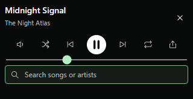
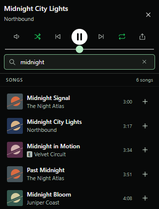

# MiniSearch

**Find your next song without leaving your mini player.**

A lightweight [Spicetify](https://spicetify.app/) extension for Spotify desktop: an always-on-top player with **song search, Play now, and Add to queue**.

**Open regular Spotify normally—MiniSearch loads with it.** Tested on Windows with Spotify **1.3.6.1921** and Spicetify **2.46.4**. Use the magnifying-glass button to open the mini player. The Microsoft Store edition has an optional separate launcher; use regular desktop Spotify if you want your usual Spotify icon to load the extension.



<details><summary>With search results</summary></details>

*Illustrative preview uses fictional music and simulated responses.*

## Prerequisites

- **Windows desktop.** The bundled installer and live testing target Windows; other operating systems have not been verified.
- **Spotify desktop**, signed in to your account. Get the regular installer using **Download directly from Spotify** on [Spotify's Windows download page](https://www.spotify.com/download/windows/). This edition lets you open Spotify normally with MiniSearch loaded.
- **Spicetify CLI**, installed and compatible with your Spotify version. The tested pairing is Spotify **1.3.6.1921** with Spicetify **2.46.4**; newer Spotify releases may need a Spicetify update.
- **PowerShell**, included with Windows, and an internet connection for song searches.

You do **not** need Node.js, Git, a Spotify developer account, an API key, or Spicetify Marketplace to install MiniSearch. The extension is free; your Spotify account's normal playback restrictions still apply. MiniSearch runs inside Spotify and requires Spotify to stay open.

## Install on Windows

### 1. Prepare Spotify

Install regular desktop Spotify, open it, sign in, and play a song once so Spotify creates its settings. Then fully quit Spotify, including its system-tray icon if present.

If you already use Microsoft Store Spotify and want to keep it, see the [Store edition instructions](#microsoft-store-edition-optional) below. For the normal Spotify launcher experience, use the regular desktop edition. This installer does not automatically uninstall either edition or migrate your account settings.

### 2. Install Spicetify

If Spicetify is already installed, skip the installation command. Otherwise, open a normal **PowerShell** window and run:

```powershell
winget install --id Spicetify.Spicetify --exact
```

If `winget` is unavailable, use one of the alternatives in the [official Spicetify setup guide](https://spicetify.app/docs/getting-started). Close and reopen PowerShell after installation, then run:

```powershell
spicetify -v
spicetify
```

The first command verifies installation; running Spicetify once initializes its configuration. Use a normal, **non-administrator** PowerShell window for MiniSearch installation.

### 3. Download MiniSearch

**[Download MiniSearch v0.3.10 ZIP](https://github.com/andrhagman/spotify-minisearch/releases/download/v0.3.10/minisearch-v0.3.10.zip)**, then choose **Extract All**. Download the `minisearch-v0.3.10.zip` asset from the [release page](https://github.com/andrhagman/spotify-minisearch/releases/tag/v0.3.10), rather than GitHub's automatically generated source-code ZIP.

Open PowerShell in the extracted folder containing `install.ps1`, `minisearch.js`, and `README.md`. Run:

```powershell
powershell -NoProfile -ExecutionPolicy Bypass -File .\install.ps1
```

The installer registers MiniSearch in Spicetify and applies it to Spotify. Other registered extensions are preserved. Spicetify may ask to refresh its Spotify backup; read and answer its prompt to continue.

### 4. Open the mini player

Open Spotify using your **normal Spotify icon**. Click the **MiniSearch magnifying-glass button** in the top bar or beside the playback controls. Type a song title or artist to search; click a result to play it, or **+** to queue it.

**Ctrl+Shift+K** is an optional way to open MiniSearch while Spotify is focused. A special launcher or keyboard shortcut is not required for the regular desktop edition. Spotify's original mini player is a separate feature; use the MiniSearch search icon for this extension.

## Microsoft Store edition (optional)

The Store edition requires a **separate Spotify MiniSearch launcher**. It does not load the extension when opened through its original Spotify shortcut. Regular desktop Spotify is recommended if you want to avoid this extra launcher.

1. Open Store Spotify, sign in, and play a song once, then quit it.
2. Install and initialize Spicetify as above.
3. Extract the release ZIP and run `install.ps1` using the command above.
4. Open the generated **Spotify MiniSearch** desktop shortcut, then click the MiniSearch magnifying glass.

The Store search, playback, and queue path was tested with the versions listed above. Automatic rebuilding after a future Store update has not been verified live.

### How the Store launcher works

Spicetify supports the Store edition through `--app-directory`, but launching its default writable folder did not work on the tested machine. MiniSearch copies the prepared UI assets into **the Store package's own `LocalState\MiniSearchApps` folder** and launches the installed Store app with that directory. This was verified with live search, playback, and queueing.

The Store executable, installed package, account and original shortcut remain in place. MiniSearch does not modify files in `WindowsApps` or install a second Spotify client. Use the **Spotify MiniSearch** shortcut for the extension; the original shortcut opens ordinary Spotify.

The shortcut uses a small hidden PowerShell launcher, with no background polling process or scheduled task. If Spotify updates, the launcher detects the package version change and rebuilds the prepared assets using Spicetify. Future Spotify versions may require a compatible Spicetify update first. Starting the modified client while ordinary Spotify is already running restarts Spotify once so the app-directory argument takes effect.

### Manual install (regular desktop)

Copy [`minisearch.js`](https://github.com/andrhagman/spotify-minisearch/releases/download/v0.3.10/minisearch.js) into Spicetify's **Extensions** folder, alongside the configuration located by `spicetify -c`. On Windows this is usually `%APPDATA%\spicetify\Extensions\`.

```powershell
spicetify config extensions minisearch.js
spicetify backup apply
```

For the Store edition, use the release ZIP installer so the writable asset directory and launcher are set up as well.

## Use

- Type a **song title or artist**. Search starts after a short pause; **Enter** searches immediately.
- Click a result to **play it now**. Click **+** to **add it to your queue**.
- Clicking another window clears the search field and results. Moving between controls inside MiniSearch keeps the search.
- The player initially opens at **320×148**, then remembers your window size and position across Spotify restarts. Results appear in a dropdown only when songs are found; clearing search collapses the window.
- Playback controls, a volume popover, shuffle, repeat, and copy-song-link stay above search.
- Drag the MiniSearch header to move the window. Resize using the native frame; results scroll inside it.

| Shortcut | Action |
| --- | --- |
| **Ctrl+Shift+K** | Open/close MiniSearch while Spotify is focused, including search fields |
| **Ctrl+F** | Focus the mini player's search field |
| **Down / Up** | Navigate result Play buttons |
| **Tab / Shift+Tab** | Navigate all controls, including queue buttons |
| **Esc** | Clear search and dismiss popovers; the mini player stays open |

Spotify's original mini player stays available. MiniSearch has its **own magnifying-glass button**. Only one Document Picture-in-Picture window can be open at a time. Spotify must stay running. Borderless/windowed games work better with always-on-top windows than exclusive fullscreen.

## Troubleshooting

- **Store app opens without MiniSearch:** use the **Spotify MiniSearch** desktop shortcut. If needed, rerun the installer after updating Spicetify.
- **No button:** check `spicetify config extensions`, apply again, and reopen from the appropriate shortcut.
- **`spicetify` is not recognized:** reopen PowerShell after installing Spicetify. Follow the official setup guide if the command is still missing.
- **`install.ps1` cannot be found:** extract the release ZIP first and open PowerShell in the folder containing that file. Running the command from another folder will not find it.
- **PiP unavailable:** update Spotify and Spicetify to compatible versions. The extension reports missing picture-in-picture support explicitly.
- **Search unavailable:** check your connection/login and retry with Enter. MiniSearch uses the client's native search definition (`searchDesktop` or `searchModalResults`) and falls back to authenticated REST search. No private query hashes are hardcoded. Current modal search returns mixed top matches; MiniSearch displays the song matches and omits durations when Spotify does not supply them.
- **Store launcher error:** inspect `%LOCALAPPDATA%\SpotifyMiniSearch\launcher.log`. The launcher also shows a message if rebuilding after an update fails.
- **After Spotify updates:** a compatible [Spicetify update](https://spicetify.app/docs/faq) may be needed. Older and future Spotify releases have not all been tested.

## Update MiniSearch

Download and extract the newer release ZIP. For regular desktop Spotify with Spicetify already applied, run these commands from the extracted folder:

```powershell
powershell -NoProfile -ExecutionPolicy Bypass -File .\install.ps1 -SkipApply
spicetify apply
```

Then fully quit and reopen Spotify. For the Store edition, rerun `install.ps1` without `-SkipApply`, then use the Spotify MiniSearch launcher. If Spotify itself has updated, first make sure your Spicetify version supports it and follow Spicetify's update instructions.

## Remove

From the extracted release folder:

```powershell
powershell -NoProfile -ExecutionPolicy Bypass -File .\install.ps1 -Uninstall
```

Then close Spotify and reopen it using the original shortcut. The script unregisters MiniSearch, removes its extension file and its desktop shortcut, and preserves other extensions. Prepared UI files and launcher files may remain in their dedicated folders; they are inactive when you use the original shortcut.

## Privacy

No telemetry, analytics, external music services, persistent search history, or extension update checks. Searches go to Spotify through Spicetify's authenticated API wrapper; artwork loads from URLs returned by Spotify. MiniSearch does not read or store your access token. Queries and results stay in memory and are discarded on close or when the mini player loses window focus. Window size and position are saved locally in Spotify's browser storage. The Store launcher checks the **local** installed package version; it does not use remote debugging or open a debugging port.

## Develop

The extension is **one JavaScript file** with no runtime dependencies or build step. Tests require Node.js 22+ and pnpm 11.25.0.

```sh
pnpm install --frozen-lockfile
pnpm check
pnpm test
pnpm exec playwright install chromium
pnpm test:ui
pnpm preview
```

The localhost preview uses simulated Spotify responses and does not play audio. Browser tests generate their own illustrative artwork. To test using installed Microsoft Edge on Windows, set `$env:MINISEARCH_BROWSER_CHANNEL = 'msedge'` before `pnpm test:ui`. Run `powershell -NoProfile -File tests/installer.ps1` to test installation against an isolated fake installation.

See [validation details](docs/VALIDATION.md), [installer source](scripts/install.ps1), and [Store launcher source](scripts/launch-store.ps1). This repository includes a Spicetify `manifest.json`; it has not been submitted to the community Marketplace.

## License

[MIT](LICENSE) — Andreas Hagman. Independent and unofficial; not affiliated with Spotify or Spicetify. Uses [Spicetify's extension APIs](https://spicetify.app/docs/development/extensions) and Document Picture-in-Picture. Spotify itself is not included in downloads.
